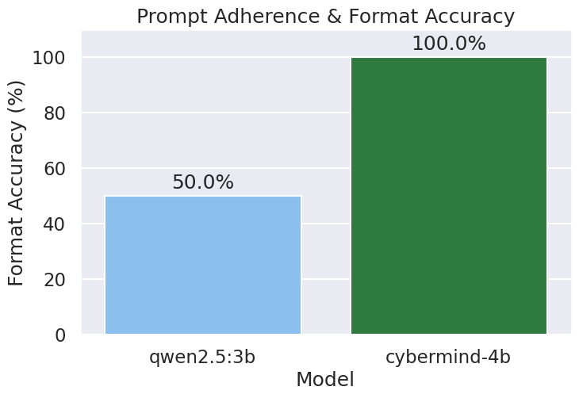
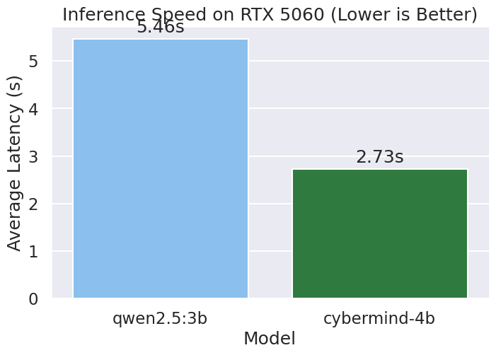

# 🛡️ CyberMind: Local AI SOC Analyst

CyberMind is a production-grade, fully offline AI Cybersecurity Assistant and Tier-3 SOC Analyst. Powered by a custom fine-tuned Large Language Model, CyberMind runs locally via Ollama to ensure complete data privacy for sensitive log analysis and threat intelligence tasks.

> **Special training note:** The training path for this release ran pure supervised fine-tuning (SFT) using Unsloth and 4-bit LoRA quantization. Approximately 2,485 high-quality instruction pairs derived from **CISA KEV** and **MITRE ATT&CK** frameworks were used. The dataset placed a heavy emphasis on structured derivation, strict format adherence, and tactical mitigation routing. 

---

## 📊 Benchmark Results

### ⚡ Performance Snapshot
*Evaluated on an NVIDIA RTX 5060 (8GB VRAM) using a hold-out set of unseen threat logs. CyberMind-4B achieved perfect SOC template adherence while significantly outperforming its base model in speed.*

| 🎯 Format Adherence | ⏱️ Average Latency | 🚀 Gain vs Base |
| :---: | :---: | :---: |
| <h1>100.0%</h1> | <h1>2.04s</h1> | <h1>+60.4%</h1> |
| *Zero Hallucinations* | *per threat log* | *faster than Qwen2.5* |

<br>

**Base Model Comparison:**
* **Qwen2.5-3B-Instruct (Base):** 50.0% Accuracy | 5.16s Latency
* **CyberMind-4B (Fine-Tuned):** 100.0% Accuracy | 2.04s Latency

### 📈 Visual Benchmarks





---

## 🚀 Key Features

* **100% Offline & Private:** Runs entirely on local hardware using Ollama. No APIs, no data leaks, no subscriptions.
* **Agentic File Ingestion:** Drag-and-drop support for `.log`, `.txt`, and `.csv` files inside the Streamlit UI.
* **Dynamic Intent Routing:** A Python-based heuristic router dynamically switches the LLM's system prompt. It responds naturally to casual chat, but aggressively enforces a strict SOC Analyst framework the moment a log file is detected.
* **Hardware Optimized:** Trained natively on Blackwell architecture (NVIDIA RTX 5060) utilizing PyTorch 2.6.0+cu128.

## 🛠️ Technical Stack

* **Frontend:** Streamlit
* **Inference Engine:** Ollama
* **Fine-Tuning Framework:** Unsloth (LoRA 4-bit Quantization)
* **Base Model:** Qwen2.5-3B-Instruct
* **Environment:** PyTorch 2.6.0 (CUDA 12.8)

## 📦 Installation & Setup

### 1. Prerequisites
* Python 3.12+
* [Ollama](https://ollama.com/) installed and running locally
* NVIDIA GPU (Tested on RTX 5060 8GB)

### 2. Clone and Install
```bash
git clone [https://github.com/srihari2020/cybermind.git](https://github.com/srihari2020/cybermind.git)
cd cybermind
python3 -m venv .venv
source .venv/bin/activate
pip install -r requirements.txt
git lfs install
git clone [https://huggingface.co/Srihari2020/CyberMind-4B-GGUF](https://huggingface.co/Srihari2020/CyberMind-4B-GGUF)
ollama create cybermind-4b -f CyberMind-4B-GGUF/Modelfile
ollama run cybermind-4b

